

<a href="https://portfolio.aryanpaltech.in">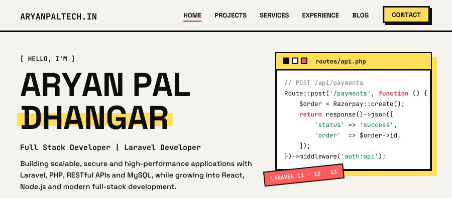</a>

 

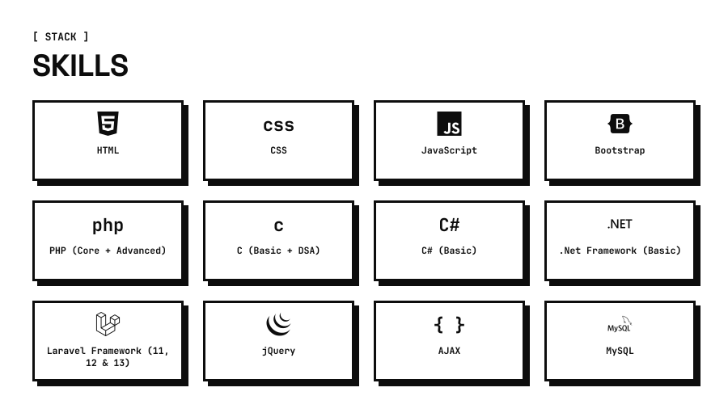

<a href="https://portfolio.aryanpaltech.in/services">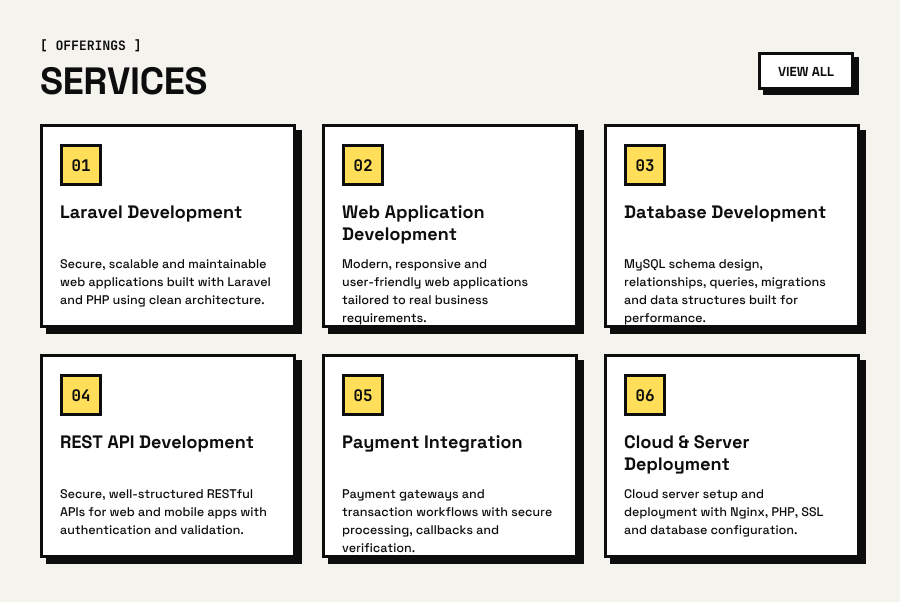</a>

<a href="https://portfolio.aryanpaltech.in/projects">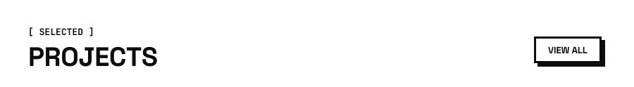</a>
<a href="https://portfolio.aryanpaltech.in/projects/xpskillsin">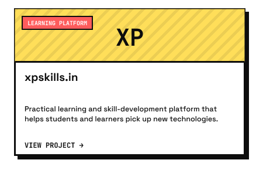</a>
<a href="https://portfolio.aryanpaltech.in/projects/updesco-aec-platform">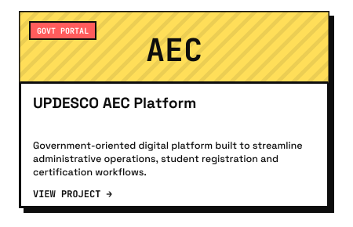</a>
<a href="https://portfolio.aryanpaltech.in/projects/namma-advocate">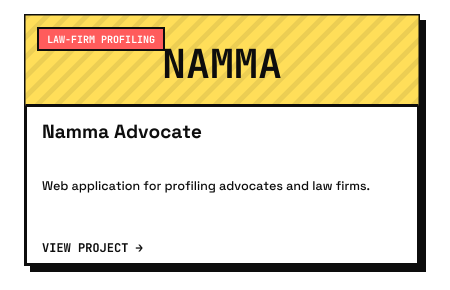</a>
<a href="https://portfolio.aryanpaltech.in/projects/jg-hoshiery-fieldsales-project">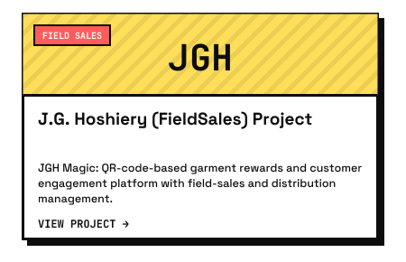</a>

<a href="https://portfolio.aryanpaltech.in/blog">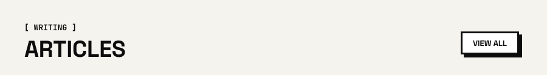</a>
<a href="https://portfolio.aryanpaltech.in/blog/getting-started-with-modern-web-development">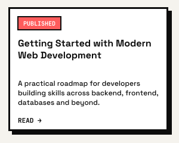</a>
<a href="https://portfolio.aryanpaltech.in/blog/building-report-generation-workflows-in-laravel">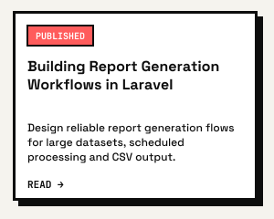</a>
<a href="https://portfolio.aryanpaltech.in/blog/deploying-laravel-applications-on-a-cloud-server">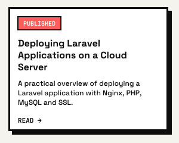</a>
<a href="https://portfolio.aryanpaltech.in/blog/api-error-handling-in-laravel">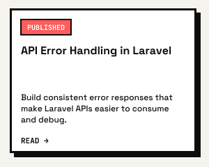</a>
<a href="https://portfolio.aryanpaltech.in/blog/designing-clean-laravel-database-migrations">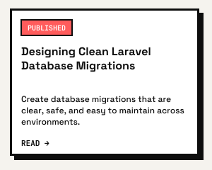</a>
<a href="https://portfolio.aryanpaltech.in/blog/laravel-queues-for-background-processing">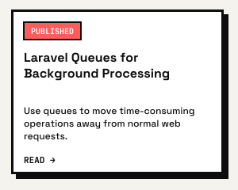</a>

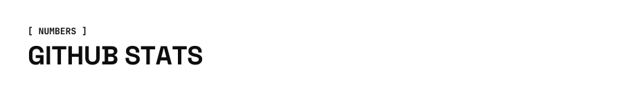

 

 

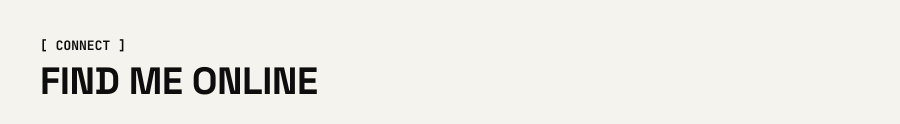

<a href="https://portfolio.aryanpaltech.in/contact">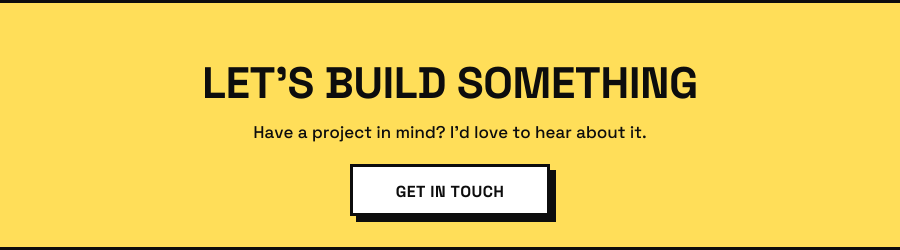</a>
<a href="https://portfolio.aryanpaltech.in">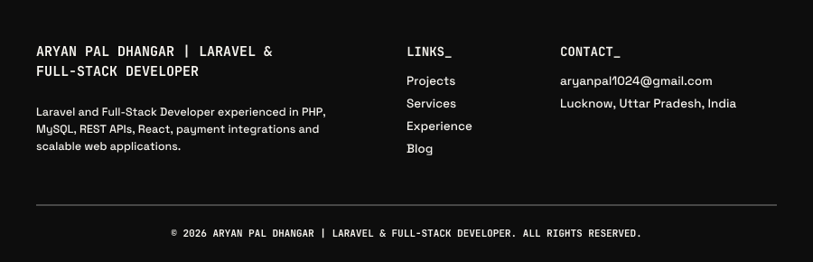</a>

